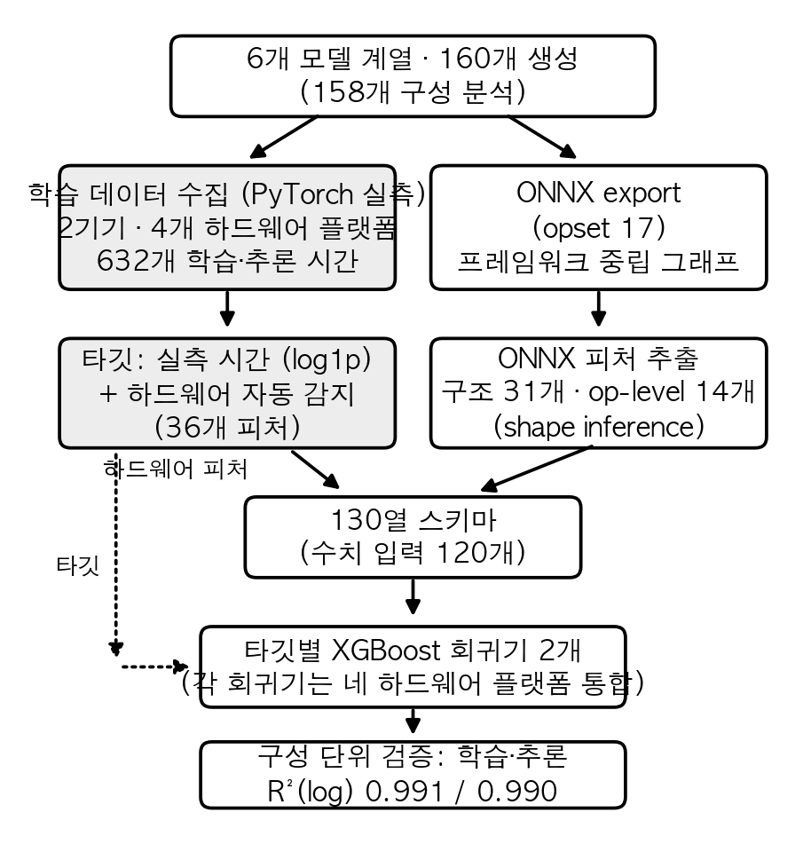

<!-- RACS 2026 제출 원고 (작업·제출 통합본, 8쪽).
     빌드: python paper/build_pdf.py 50_draft_v4.md  /  python paper/build_hwp_docx.py
     용어: 백엔드→하드웨어 플랫폼, 벤치마크→학습 데이터. 브랜드 용어 제거(기기명 Apple M4·MPS는 유지).
     1차 피드백(RACS2026_이준수-검토.pdf) 반영: 제목·저자·초록·절 제목. -->

# 다양한 하드웨어 플랫폼에서 심층신경망 실행시간 예측을 위한 기계학습 모델

**저자**: 김홍근, 이준수, 허준영
**소속**: 한성대학교 컴퓨터공학부
**이메일**: khg9859@gmail.com, dlwnstni74@gmail.com, jyheo@hansung.ac.kr

**Title**: Machine Learning Model for Predicting Execution Time of Deep Neural Networks on Diverse Hardware Platforms

**Authors**: Hong-Geun Kim, Jun-Soo Lee, Junyoung Heo
**Affiliation**: Division of Computer Engineering, Hansung University

---

## 요 약

심층신경망 모델의 실행 시간은 하드웨어 플랫폼과 모델 계열에 따라 수십 배 이상 차이가 난다. 본 논문의 실험에서도 Apple GPU(MPS)에서는 MobileNet 계열의 실행 시간이 ARM CPU보다 평균 약 35배 빨랐지만, ANN 계열에서는 실행 시간이 오히려 평균 약 2배 느렸다. 따라서 모델의 FLOPs만으로 실행 시간을 예측하는 것은 매우 어렵다. 본 논문은 ONNX 모델에서 추출한 구조·op-level 피처와 실행 하드웨어 정보를 이용하여 심층신경망의 실행 시간을 예측하는 기계학습 모델을 제안한다. 실행 하드웨어는 x86 CPU, CUDA GPU, Apple ARM CPU, Apple MPS를 대상으로 하였다. 158개의 심층신경망 모델 구성을 4가지 하드웨어에서 실행하여 총 632개의 실행 시간 데이터를 수집하였다. 수집 데이터를 이용하여 학습시간과 추론 시간 각각에 대해 XGBoost를 사용하여 실행 시간 예측 모델을 설계하였다. 구성 단위 5-겹 중첩 교차검증에서 R²(log)는 학습 0.991, 추론 0.990으로 제안 모델의 예측력이 매우 높음을 보였다.

---

## 1. 서 론

같은 심층신경망 모델이라도 어떤 하드웨어에서 실행하느냐에 따라 실행 시간이 수십 배까지 차이 난다. 더구나 그 차이는 "어떤 하드웨어가 항상 더 빠르다"로 정리되지 않는다 [1]. 본 논문의 측정에서도 Apple MPS는 MobileNet 계열에서 ARM CPU보다 평균 약 35배 빨랐지만, ANN 계열에서는 오히려 평균 약 2배 느렸다(표 3). 이렇게 유불리가 모델에 따라 뒤바뀌는 이유는, 실행 시간이 연산량뿐 아니라 메모리 대역폭과 하드웨어별 소프트웨어 라이브러리(oneDNN, cuDNN, MPSGraph, Accelerate 등)의 성숙도까지 함께 작용해 정해지기 때문이다. 다만 본 실험은 각 라이브러리의 효과를 따로 떼어 측정하지는 않았으므로, 특정 라이브러리의 부재를 직접적인 원인으로 단정하지는 않는다. 요컨대 구조만 보는 지표나 하드웨어별 고정 배율(특정 하드웨어가 항상 일정 배수만큼 빠르다는 가정)로는 실행 시간을 맞힐 수 없고, 실행 환경까지 피처로 학습하는 모델이 필요하다.

모델을 배포하기 전에 "이 모델이 너무 느리지 않은가"를 알려면 보통 직접 실행해 시간을 잰다. 그러나 신경망 구조 탐색(NAS)처럼 후보 모델이 수백 개면, 이들을 하드웨어마다 일일이 돌려 보기는 현실적으로 어렵다. 대안으로 흔히 쓰는 FLOPs(연산량)는 실제 시간에 잘 비례하지 않는다 [11]. 연산량이 같은 두 모델이라도 메모리 접근 방식과 병렬 처리 효율에 따라 시간이 달라지기 때문이다 [2][3].

실행 시간을 예측하려는 기존 연구는 이 문제를 일부만 다룬다(§2). 대부분의 학습형 예측기 [2][5][9]는 한 종류의 GPU만 대상으로 하고, nn-Meter [4]나 엣지 기기 연구 [13][14][15]는 주로 추론 지연에 집중한다. 반면 본 연구는 Apple M4 CPU/MPS를 포함한 네 종류의 하드웨어를 하나의 모델로 함께 다루며, 학습 시간(1 에폭)과 추론 시간(전체 테스트셋)을 각각 별도의 회귀기로 예측한다.

본 논문의 기여는 다음과 같다.

- **네 하드웨어 플랫폼의 통합 예측**: 하드웨어를 피처로 인코딩해 x86 CPU·CUDA·Apple ARM CPU·Apple MPS를 타깃별 단일 회귀기로 예측한다(§4.1).
- **학습시간 예측 인자의 교차 검증**: 정적 메모리 쓰기 프록시가 FLOPs보다 일관된 예측 중요도를 보이는지 절제와 그룹 공동 permutation으로 검증한다(§4.3).

## 2. 관련 연구

신경망의 실행 비용을 실측 데이터로 학습해 예측하는 연구는 크게 세 갈래로 나뉜다. 표 1은 본 연구와 가까운 선행 연구를 대상 하드웨어·예측 타깃·미지 기기 처리 방식으로 비교한 것이다.

**학습형 실행시간 예측기.** 본 연구와 가장 가까운 것은 Justus 등 [2]과 PreNeT [5]으로, 둘 다 층 단위 또는 모델 단위 피처에 하드웨어 피처를 더한 단일 회귀 모델로 학습시간을 예측하고 미지의 GPU에 일반화한다. 그러나 대상이 모두 단일 벤더(NVIDIA) GPU다. Habitat [9]은 한 GPU에서의 실측을 파장 스케일링과 커널별 예측기로 다른 GPU로 변환하므로, 소스 기기의 실측이 항상 필요하다. nn-Meter [4]는 추론 그래프를 커널 단위로 분해해 모바일·엣지 기기별 예측기를 학습하며 높은 정확도를 보이지만, 기기마다 예측기를 새로 만들어야 하고 학습시간은 다루지 않는다. 학습형 비용 모델은 컴파일러 영역에서도 쓰여, Kaufman 등 [16]은 TPU 커널의 실행시간을 그래프 신경망으로 예측해 컴파일 최적화에 활용하였고, BRP-NAS [17]는 구조 탐색을 위해 GCN 기반 지연 예측기를 학습하였다. 이들은 특정 가속기나 추론 지연에 특화되어 있다.

**미지 하드웨어로의 일반화.** HELP [13]는 지연 예측을 기기별 과제로 보고 메타학습을 적용해, 새 기기에서 소수의 측정만으로 예측기를 적응시킨다. MAPLE-Edge [14]는 운영체제의 런타임 카운터로 기기를 표현해 엣지 기기 간 전이를 시도하며, CloserToMe [15]는 소수의 기준 측정으로 기기 간 지연 예측을 전이한다. 이 계열은 미지 기기 적응이 목표라는 점에서 본 연구보다 일반화 범위가 넓지만, 본 연구가 다루는 고정 1 에폭 학습시간까지 함께 예측하지는 않는다. 본 연구는 미지 기기 일반화를 주장하지 않고, 등록된 네 하드웨어 플랫폼 안에서 학습시간과 추론시간을 예측한다.

**분석적 모델과 FLOPs의 한계.** Paleo [10]는 연산량과 통신량을 하드웨어 사양으로 나눠 실행시간을 계산하는 분석적 모델이지만, 플랫폼마다 효율 상수(PPP)를 수동으로 맞춰야 한다. Roofline [3]은 실행 시간이 연산과 메모리 중 병목인 쪽에 지배됨을 보이는 고전적 틀로, 본 연구의 피처 중요도 해석(§4.3)의 배경이 된다. FLOPs가 지연의 나쁜 대리지표라는 점은 효율적 구조 설계 문헌에서 플랫폼 의존적으로 확립되었다 [11]. 본 논문은 이들과 달리 Apple M4 CPU/MPS를 포함한 PyTorch 기반 네 하드웨어 플랫폼에서 고정 1 에폭 학습시간과 전체 데이터셋 추론시간을 ONNX 기반 정적 피처로 함께 예측한다는 점에서 구별된다.

[표 1] 실행 비용 예측 선행 연구와 본 연구의 비교

| 연구 | 대상 하드웨어 | 예측 타깃 | 미지 기기 처리 |
|---|---|---|---|
| Justus 등 [2] | NVIDIA GPU | 학습 배치 시간 | 하드웨어 피처로 일반화 |
| PreNeT [5] | NVIDIA GPU | 학습시간 | 하드웨어 피처로 일반화 |
| Habitat [9] | NVIDIA GPU | 학습 반복 시간 | 소스 GPU 실측 필요 |
| nn-Meter [4] | 모바일 CPU·GPU·VPU | 추론 지연 | 기기별 예측기 재학습 |
| HELP [13] | 이종 기기 풀 | 추론 지연 | 메타학습 few-shot 적응 |
| MAPLE-Edge [14] | 엣지 기기 | 추론 지연 | 런타임 카운터 전이 |
| CloserToMe [15] | 이종 기기 풀 | 실행 지연 | 기준 측정 기반 전이 |
| Paleo [10] | 임의(분석식) | 학습·추론 | 효율 상수 수동 보정 |
| 본 연구 | x86 CPU·CUDA·Apple CPU/MPS | 1에폭 학습 + 전체셋 추론 | 미지원 (등록 플랫폼 내 예측) |

## 3. 실행 시간 예측 모델

그림 1은 전체 과정을 보여준다. 먼저 여러 모델 구성을 두 기기에서 실행해 학습·추론 시간을 직접 측정한다(§3.1). 같은 구성을 ONNX 그래프로 변환해 모델 구조와 연산 단위(op-level) 피처를 뽑고(§3.3), 여기에 실행 시점에 기록한 구성·하드웨어 정보를 합친다. 이렇게 만든 피처로, 네 하드웨어를 함께 다루는 예측기를 학습 시간용과 추론 시간용으로 하나씩 만든다(§3.4).

[그림 1] 제안 파이프라인. 실측 경로(왼쪽)는 타깃과 하드웨어 피처를, ONNX 경로(오른쪽)는 구조·op-level 피처를 공급한다.

### 3.1 학습 데이터 수집

예측 모델을 학습시키려면 "모델 구성 → 실행 시간" 쌍이 많이 필요하다. 이를 위해 6개 계열(ANN, CNN, ResNet, MobileNet, ViT [6], GAN)의 모델을 폭(은닉 크기·필터 수·임베딩 차원)과 깊이(층 수·블록 수)를 바꿔 가며 만들었고, 계열별로 ANN 42개, CNN 60개, ResNet 18개, MobileNet 20개, ViT 12개, GAN 8개씩 총 160개 구성을 얻었다. ANN부터 MobileNet까지는 MNIST(28×28 흑백)를, ViT와 GAN은 CIFAR-10(32×32 컬러)을 쓰는 소규모 모델이다. 이 중 x86 CPU 측정이 불완전한 ViT 2개 구성은 빼고, 158개 구성을 네 하드웨어에서 각각 실행해 총 632개(158×4) 샘플을 학습 데이터로 삼았다(표 2). 같은 구성을 한 하드웨어에서 여러 번 잰 경우(Mac CPU 48개 구성)는 평균을 내 하나로 합쳤다.

측정은 다음 규칙을 따랐다 [12]. 학습 시간은 학습셋 전체를 1 에폭 도는 벽시계 시간이고, 추론 시간은 테스트셋 전체(1만 장)를 한 번 통과시키는 시간이다. 각 구성을 10번 재서 단순 평균을 썼다. 첫 실행의 초기화 비용을 빼기 위해 GPU(CUDA·MPS)에서는 비-GAN 모델에 한해 측정 전 더미 실행으로 워밍업했고(CPU와 GAN은 생략), GPU는 매번 동기화했다. 데이터는 미리 장치 메모리에 올려 전송 시간을 분리했고, 모델을 만들고 장치로 옮기는 시간은 측정에서 뺐다. 학습 시간에는 순전파·역전파·가중치 갱신이 모두 들어가며, 수렴까지가 아니라 정해진 1 에폭만큼의 처리 시간이다. 분류 추론 시간에는 순전파와 함께 정답 비교(argmax·호스트 동기화)가 포함된다. 배치 크기는 학습 64, 추론 1,000으로 모든 하드웨어에서 같게 고정했다. 이처럼 모델·입력·배치·연산을 모두 맞추고 하드웨어와 소프트웨어만 달리했으므로, 플랫폼 간 시간 차이는 통제된 조건에서의 비교다. 하드웨어 정보는 실행 시점에 자동으로 감지해 피처로 저장했다. 학습 설정은 분류가 SGD(학습률 0.01)+교차엔트로피, GAN이 Adam(2×10⁻⁴, β=0.5/0.999)+BCE이고 모두 FP32다. MacBook은 Python 3.13·PyTorch 2.10에서, 데스크톱은 Windows 11의 CUDA 지원 PyTorch에서 측정했으나 데스크톱의 세부 버전은 기록이 남지 않았다.

GAN은 학습·측정 방식이 분류 모델과 달라 따로 설명한다. 학습 시간은 생성기와 판별기를 함께 1 에폭 학습한 시간으로 분류 계열과 단위가 같다. 그러나 추론 시간은 생성기가 이미지를 약 5만 장 만들어 내는 시간이라, 분류 모델의 추론(1만 장 통과)과 절대값을 곧바로 비교할 수 없다. 그래서 예측기는 GAN까지 포함해 하나로 학습하되, §4.1에서 오차를 볼 때만 GAN과 나머지를 나눠 따로 보고한다.

[표 2] 학습 데이터 구성 (158개 구성 × 4개 하드웨어 플랫폼 = 총 632 샘플)

| 기기 | 하드웨어 플랫폼 | 샘플 수 |
|---|---|---:|
| Desktop (Ryzen 7 7800X3D) | x86 CPU | 158 |
| Desktop (RTX 4060 Ti) | CUDA | 158 |
| MacBook (Apple M4) | ARM CPU | 158 |
| MacBook (Apple M4, 24GB) | MPS | 158 |

### 3.2 플랫폼 간 실행 특성 차이

같은 모델 구성이라도 하드웨어에 따라 실행 시간이 수십 배까지 벌어지고, 어느 쪽이 빠른지도 뒤바뀐다(표 3). MobileNet 계열은 Apple ARM CPU에서 데스크톱 x86 CPU보다 평균 14배 느리지만, 같은 Mac에서 MPS로 돌리면 ARM CPU보다 평균 35배 빨라진다. 반대로 ANN 계열은 평균적으로 MPS가 ARM CPU보다 약 2배 느리고, 가장 작은 구성 `ANN_h16_l1`에서는 약 3.55배까지 느렸다. 이런 뒤바뀜에는 depthwise 합성곱이 하드웨어마다 최적화된 정도와, 작은 모델에서 커널 실행 자체의 고정 비용이 영향을 준 것으로 보인다. 다만 원인을 하나씩 분리해 확인하지는 않았으므로, 표 3은 인과관계가 아니라 하드웨어에 따라 실행 특성이 달라진다는 관찰로 본다.

[표 3] 플랫폼 간 상대 학습시간 (동일 구성 쌍의 시간 비를 계열별로 평균. 값>1은 1행에서 Mac CPU가 느림을, 2행에서 MPS가 빠름을 뜻함)

| 비교 | ANN | CNN | ResNet | MobileNet | ViT | GAN |
|---|---:|---:|---:|---:|---:|---:|
| Mac CPU 시간 / Desktop CPU 시간 | 0.5 | 2.1 | 2.5 | **14.0** | 0.9 | 0.6 |
| MPS 가속 (Mac CPU 시간 / MPS 시간) | 0.5 | 5.1 | 7.1 | **35.0** | 2.7 | 1.7 |

이렇게 유불리가 뒤바뀌는 현상은 다른 기기에서도 나타났다. 주 분석에는 넣지 않은 MacBook Air M1에서 따로 잰 151건을 보면, MPS가 CPU보다 몇 배 빠른지(중앙값)가 CNN 2.2·ViT 1.6으로 1을 넘는 반면 GAN은 1.0, 가장 작은 ANN은 0.6이었다. 세대가 다른 두 기기에서 같은 경향이 보인 점은 참고가 되지만, 측정 방식이 달라 이 결과는 보조적인 확인용으로만 쓴다.

### 3.3 ONNX 그래프 기반 피처 스키마

모든 구성을 ONNX(opset 17) 그래프로 변환한다. 여기서 ONNX는 실행 엔진이 아니라 "모델을 표준 형식으로 적어 두는" 용도다. 실제로 재려는 것은 PyTorch에서의 실행 시간이라 시간 자체는 PyTorch에서 측정하며, ONNX는 추론 그래프 표준이어서 역전파가 포함된 학습 시간은 잴 수 없기 때문이다. 피처는 모두 130열이고, 이 중 문자열 10열을 뺀 수치 120열이 실제 모델 입력이다(표 4). 130열은 네 종류로 나뉜다. 모델 구조(69열) 중 31열은 파라미터 수·레이어 수처럼 ONNX 그래프에서 바로 얻고, 나머지 38열은 폭·깊이·계열처럼 구성에서 가져온다. 입력 데이터 범주는 해상도·채널 수·배치 크기를, 하드웨어 범주는 장치 종류·CPU 코어 수와 주파수·GPU 메모리 등을 담는다. 수집기가 채우지 못한 하드웨어 항목은 0으로 두는데, 모든 행에서 같은 값이라 예측에는 영향을 주지 않는다. 마지막으로 op-level 범주는 ONNX 그래프의 각 연산에서 입출력 텐서 크기를 계산해, 레이어별 연산량 비율과 메모리 읽기·쓰기 추정값을 만든다.

[표 4] 피처 스키마 구성 (스키마 130열 = 수치 120 + 문자열 10. 실제 학습 입력은 수치 120개)

| 범주 | 열 수 | 대표 피처 | 출처 |
|---|---:|---|---|
| 모델 구조 | 69 | `total_params`, `num_conv_layers`, `max_width` | ONNX 31 + 구성 메타데이터 38 |
| 입력 데이터 | 11 | `input_height`, `batch_size` | 실측 메타데이터 |
| 하드웨어 | 36 | `cpu_cores`, `gpu_memory_gb`, `ram_total_gb` | 실측 메타데이터 |
| op-level 분해 | 14 | `total_op_memory_write`, `flops_ratio_*` | ONNX 그래프 |

여기서 read는 각 연산이 읽는 입력·가중치 바이트 수, write는 내보내는 출력 바이트 수의 합이다. 이는 배치 1의 순전파 그래프에서 계산한 어림값(정적 **프록시**)일 뿐, 실제 메모리 트래픽이나 캐시 재사용, 역전파·옵티마이저의 접근까지 잰 값은 아니다. 그래도 쓸모가 있는데, 예를 들어 완전연결 층과 합성곱 층은 연산량이 같아도 중간에 만들어내는 텐서 크기가 크게 달라서, 이 값이 "연산량이 같아도 구성에 따라 시간이 다르다"는 차이를 담아내기 때문이다.

### 3.4 예측 모델 학습

예측하려는 학습·추론 시간은 밀리초에서 수천 초까지 범위가 아주 넓다. 이대로 회귀하면 큰 값의 오차가 학습을 지배하므로, 시간에 `log1p`를 취해 학습하고 결과는 `expm1`로 되돌린다. 학습 시간용과 추론 시간용 회귀기를 따로 두며, "통합"이라는 말은 회귀기 하나가 네 하드웨어를 함께 예측한다는 뜻이다. 회귀 알고리즘은 LinearRegression, RandomForest, GradientBoosting, XGBoost [8]를 같은 조건에서 비교한다. 하이퍼파라미터는 중첩 교차검증으로 고른다. 즉 바깥 5-겹으로 나눈 각 학습 폴드 안에서 다시 4-겹 GridSearchCV로 최적값을 찾으며, 탐색 범위는 XGBoost가 트리 수 {200, 400}×최대 깊이 {3, 6}(학습률 0.1), RandomForest가 트리 수 {100, 200}×최대 깊이 {제한 없음, 12}이고, GradientBoosting과 LinearRegression은 기본 설정을 쓴다.

### 3.5 검증 프로토콜

제안 모델은 "어떤 대상으로의 일반화인가"에 따라 서로 다른 두 가지 평가 프로토콜로 검증하며, 이후 모든 절과 표에서 같은 이름으로 부른다. 표 5는 각 프로토콜이 던지는 질문과 결과를 보고하는 절을 정리한 것이다.

- **무작위 분할(random 5-fold CV)**: 632개 샘플을 무작위로 5개 폴드로 나눠 매 폴드에서 80%(약 506개)로 학습하고 20%(약 126개)로 검증한다. 전 샘플이 정확히 한 번씩 검증에 쓰이며, 모델의 기본 예측력을 본다(§4.1).
- **구성 단위 분할(configuration-wise GroupKFold)**: 동일 구성의 네 하드웨어 플랫폼 측정을 반드시 같은 폴드에 묶어, 검증 폴드의 구성이 학습에 전혀 등장하지 않게 한다(분할 비율 80/20 동일). 무작위 분할에서 같은 구성의 다른 플랫폼 측정이 학습·검증에 나뉘어 성능이 낙관되는 것을 통제해, 학습에 없던 구성으로의 일반화를 본다(§4.2).

두 프로토콜 모두 §3.4의 중첩 교차검증으로 하이퍼파라미터를 고른다. 성능 지표는 로그 공간에서 잰 결정계수 R²(log)를 주로 쓰고, 다른 연구와 견주기 위해 평균절대백분율오차(MAPE)와 ±20% 이내 예측 비율(오차가 20% 이하인 샘플의 비율)도 함께 보고한다. R²(log)는 폴드별 점수를 평균한 값이 아니라, 각 폴드에서 검증에 쓰인 예측을 전부 모아 한 번에 계산한 값이다.

[표 5] 성능 평가 프로토콜

| 프로토콜 | 검증하는 일반화 | 보고 |
|---|---|---|
| 무작위 분할 | 기본 예측력 | §4.1 |
| 구성 단위 분할 | 미지 구성 (누수 통제) | §4.2 |

위 프로토콜이 제안 모델의 예측 정확도를 잰다면, 기준선은 그 정확도를 위해 제안하는 학습 기반 다중 피처 모델이 정말 필요한지, 즉 더 단순한 대안으로 대체되지 않는지를 세 방향에서 반증하며 모두 구성 단위 분할 위에서 비교한다(§4.2). (i) **관행적 단일 지표로 충분한가**: ③ **`flops` 단독**(총 연산량)과 ④ **`total_params` 단독**(파라미터 수)은 구조 탐색에서 흔히 쓰는 대리지표만의 설명력을 재어, 서론의 "FLOPs만으로는 예측할 수 없다"는 전제를 정량 확인한다. (ii) **손으로 맞춘 분석식으로 충분한가**: ② **분석적 추정**(Paleo식 [10])은 연산량과 메모리 프록시를 하드웨어 peak 사양으로 나눠 더하고 플랫폼별 효율 상수 1개만 학습 폴드에서 보정한 물리 기반 근사로, 수식형 추정 대비 학습의 이득을 본다. (iii) **하드웨어 정보가 기여하는가**: ① **하드웨어 피처 제외**는 수치 입력 120개 중 하드웨어 수치 피처 30개를 제거해(고정 입력 설정인 `batch_size`는 유지) 구조 피처만으로 이종 플랫폼의 시간 차이를 구분할 수 있는지 절제한다. 세 기준선이 모두 학습 모델에 못 미치면, 단일 지표·수동 효율식·구조 단독 중 어느 것으로도 부족하고 구조·연산·하드웨어를 함께 학습하는 접근이 필요함이 드러난다.

## 4. 실험 결과

### 4.1 하드웨어 통합 예측 모델

네 하드웨어 플랫폼의 632개 샘플을 합쳐 타깃별 회귀기를 학습하고 네 알고리즘을 비교하였다(표 6). 선형 회귀는 R²(log) 0.86·0.78에 그쳐, 실행시간이 피처의 비선형 함수임을 나타낸다. 트리 앙상블 세 모델은 모두 R²(log) 0.97 이상이며, 그중 XGBoost가 학습 0.988·추론 0.989로 가장 높아 이후 분석의 기준 알고리즘으로 사용한다.

[표 6] 회귀 모델별 통합 예측 성능 (632개 샘플, 무작위 분할, R²(log))

| 회귀 모델 | 학습시간 | 추론시간 |
|---|---:|---:|
| LinearRegression | 0.855 | 0.782 |
| RandomForest | 0.981 | 0.976 |
| GradientBoosting | 0.977 | 0.979 |
| XGBoost | **0.988** | **0.989** |

무작위 분할의 교차검증 예측을 하드웨어 플랫폼별로 나누면 네 하드웨어 플랫폼 모두 R²(log) 0.95 이상이다(표 7). 원 단위에서 학습시간 MAPE는 전체 632개 기준 18.9%(±20% 이내 63.3%)였다. 추론시간 전체 MAPE는 54.1%(±20% 이내 51.4%)였으며, 상대오차는 실행시간 10ms 미만인 117개에 집중됐다. 이 구간을 제외한 515개의 MAPE는 23.4%(±20% 이내 62.3%)였다. 이 값들은 다른 데이터·프로토콜의 선행연구 수치와 직접 비교하지 않는다. 동일한 통합 회귀기의 교차검증 예측을 사후 분해하면, 10ms 이상 비-GAN 483개의 MAPE는 23.7%, GAN 32개의 MAPE는 19.2%였다. 이는 GAN 제외 재학습 결과가 아니라 하위집단별 오차다.

[표 7] 통합 모델(XGBoost)의 하드웨어 플랫폼별 예측 성능 (무작위 분할 예측을 하드웨어 플랫폼별로 분해, R²(log))

| 하드웨어 플랫폼 | 샘플 수 | 학습시간 | 추론시간 |
|---|---:|---:|---:|
| Desktop CPU | 158 | 0.988 | 0.989 |
| CUDA | 158 | 0.961 | 0.951 |
| Mac CPU | 158 | 0.990 | 0.988 |
| MPS | 158 | 0.983 | 0.979 |

### 4.2 프로토콜 강건성과 기준선 비교

§3.5의 프로토콜·기준선별 결과는 표 8과 같다. 동일 구성을 네 하드웨어 플랫폼 모두에서 검증 폴드로 묶은 구성 단위 분할에서도 R²(log)은 학습 0.991, 추론 0.990으로 무작위 분할과 비슷했다. 이 분할의 학습 MAPE는 16.6%(±20% 이내 69.6%), 10ms 이상 추론 MAPE는 20.9%였다. 따라서 §4.1의 정확도는 동일 구성이 학습과 검증에 나뉜 것만으로 설명되지 않는다. `flops` 단독은 R²(log) 0.558·0.468, `total_params` 단독은 0.171·0.296, 분석적 추정은 0.78·0.84로 학습 모델보다 낮았다. 하드웨어 수치 피처 30개를 제외하면 0.784·0.672로 떨어져, 등록된 이종 하드웨어 플랫폼을 구분하는 피처가 필요함을 확인했다.

[표 8] 검증 프로토콜·기준선 (통합 모델, XGBoost, 중첩 CV, R²(log). 정의는 §3.5)

| 설정 | 학습시간 | 추론시간 |
|---|---:|---:|
| 전체 피처, 무작위 분할 | 0.988 | 0.989 |
| 전체 피처, 구성 단위 분할 | **0.991** | **0.990** |
| 하드웨어 피처 제외 (구성 단위 분할) | 0.784 | 0.672 |
| 분석적 추정 (효율 상수는 학습 폴드에서 보정) | 0.78 | 0.84 |
| `flops` 단독 (구성 단위 분할) | 0.558 | 0.468 |
| `total_params` 단독 (구성 단위 분할) | 0.171 | 0.296 |

### 4.3 피처 중요도 — 메모리 쓰기 프록시의 일관된 우위

피처 중요도와 절제 분석(표 9·10)은 각 플랫폼의 158개 샘플로 RandomForest를 따로 학습해 수행하였다. 학습 시간 예측에서 중요도 1위 피처는 네 하드웨어 플랫폼 모두에서 정적 메모리 쓰기 프록시(`total_op_memory_write`, §3.3)였다(표 9). 순수 연산량(`flops`)의 중요도는 네 하드웨어 플랫폼에서 0.021 이하로, 5~24위였다(표 9). 이 순위가 트리 불순도의 인위적 결과가 아님은 피처 절제와 permutation 검증으로 확인하였다(표 10). 각 플랫폼에서 무작위 25% 홀드아웃을 떼어 `total_op_memory_write`를 섞으면 R²(log)이 0.52~0.99 하락하는 반면, `flops`를 섞었을 때의 하락은 네 하드웨어 플랫폼 모두 0.002 이하다. 다만 메모리 프록시 피처(read/write)를 제거해도 정확도 하락은 0.010 이하인데, 구조로부터 계산되는 파생값이라 다른 구조 피처가 대체할 수 있기 때문이다. 즉 메모리 쓰기 프록시는 유일한 정보가 아니라, 상관된 여러 피처 중 모델이 네 하드웨어 플랫폼에서 일관되게 중요도 1위로 선택한 피처다.

개별 피처 permutation은 상관 피처가 많은 쪽에 불리하므로(`flops`는 `total_op_flops` 등 유사 피처가 값을 대신할 수 있다), 상관 피처를 묶어 함께 섞는 그룹 공동 permutation으로 재검증하였다. 이 검증은 네 플랫폼을 합친 632개에서 구성 기준 75:25 분할을 5개 시드로 반복하며, 메모리 그룹(read·write 프록시)과 FLOPs 그룹(`flops`, `total_op_flops`, `num_mult_adds`, op FLOPs 통계·비율 등 14개)을 각각 통째로 섞어 R²(log) 하락폭을 쟀다. 그 결과 메모리 0.85±0.12 대 FLOPs 0.11±0.03으로 메모리 그룹이 뚜렷이 컸다. 또한 이 지배성은 워크로드 레짐에 의존한다. 완전연결 레이어는 메모리 쓰기에, 합성곱은 연산에 시간이 지배되며 [2], Roofline 관점에서 실행 시간은 연산과 메모리 중 큰 쪽에 좌우된다 [3]. 본 프록시는 실제 DRAM 트래픽의 측정값이 아니므로(§3.3), 이 결과는 "메모리 병목의 증명"이 아니라 "정적 쓰기 프록시가 본 학습 데이터 분포에서 가장 일관된 예측 인자"라는 관찰이다. 인과적 결론에는 arithmetic intensity와 실효 대역폭의 직접 측정이 필요하다.

[표 9] 학습시간 예측 상위 피처 중요도 (RandomForest). mem_write/read는 total_op_memory_write/read의 약칭.

| 하드웨어 플랫폼 | 1위 | 2위 | 3위 | `flops` 순위 |
|---|---|---|---|---|
| Desktop CPU | mem_write **0.78** | mem_read 0.06 | std_op_flops 0.03 | 7위 (0.013) |
| CUDA | mem_write **0.65** | model_family_encoded 0.09 | flops_ratio_Linear 0.06 | 5위 (0.021) |
| Mac CPU | mem_write **0.47** | conv_params 0.26 | flops_ratio_Linear 0.12 | 24위 (0.001) |
| MPS | mem_write **0.82** | mem_read 0.08 | max_op_flops 0.02 | 10위 (0.005) |

[표 10] 메모리 프록시 피처의 절제·permutation 검증 (하드웨어 플랫폼별 학습시간 모델, RandomForest, R²(log)). 절제는 mem_read/write 제거. Δperm은 무작위 25% 홀드아웃에서 해당 피처를 섞었을 때의 R²(log) 하락폭.

| 하드웨어 플랫폼 | 전체 피처 | 절제 | Δperm(write) | Δperm(flops) |
|---|---:|---:|---:|---:|
| Desktop CPU | 0.986 | 0.982 | **0.825** | 0.001 |
| CUDA | 0.971 | 0.967 | **0.521** | 0.002 |
| Mac CPU | 0.984 | 0.981 | **0.584** | 0.001 |
| MPS | 0.984 | 0.975 | **0.991** | 0.001 |

### 4.4 한계

본 연구에는 다음 한계가 있다. 메모리 사용량 타깃은 `total_params×4`로 정의되어 구조에서 결정되므로 성능 지표에서 제외하였다. 학습 배치 64와 추론 배치 1,000은 고정값이라 배치 변화는 다루지 않았고, GAN 추론은 분류와 단위가 달라 동일 통합 모델의 하위집단 오차로만 구분했다. 프로토타입 규모 아키텍처와 네 하드웨어 플랫폼에 한정되며, 학습에 포함되지 않은 하드웨어로의 일반화는 본 연구의 범위 밖이다. 데스크톱 측 Python·PyTorch·CUDA의 세부 버전도 보존되지 않아 완전한 환경 재현에 제약이 있다. 향후 대규모 모델, 다양한 배치와 추가 물리 기기에서 검증해야 한다.

## 5. 결 론

본 논문은 6개 아키텍처 계열을 두 기기·네 하드웨어 플랫폼에서 측정하고, ONNX 구조·op-level 피처와 구성·하드웨어 메타데이터를 결합한 타깃별 통합 회귀기를 제안했다. Apple M4 CPU/MPS를 포함한 PyTorch 기반 네 하드웨어 플랫폼에서 고정 1 에폭 학습시간과 전체 데이터셋 추론시간을 예측했으며, 학습에 없던 구성에서 R²(log) 0.991·0.990을 얻었다. 학습시간 모델에서는 정적 메모리 쓰기 프록시가 FLOPs보다 일관된 중요도를 보였다. 향후 실측 피크 메모리, 다양한 배치와 추가 물리 기기를 포함해 적용 범위를 확장할 계획이다.

## 참고 문헌

[1] A. G. Howard et al., "MobileNets: Efficient Convolutional Neural Networks for Mobile Vision Applications," arXiv:1704.04861, 2017.

[2] D. Justus, J. Brennan, S. Bonner, A. S. McGough, "Predicting the Computational Cost of Deep Learning Models," in Proc. IEEE Int'l Conf. on Big Data, pp. 3873–3882, 2018.

[3] S. Williams, A. Waterman, D. Patterson, "Roofline: An Insightful Visual Performance Model for Multicore Architectures," Commun. ACM, vol. 52, no. 4, pp. 65–76, 2009.

[4] L. L. Zhang, S. Han, J. Wei, N. Zheng, T. Cao, Y. Yang, Y. Liu, "nn-Meter: Towards Accurate Latency Prediction of Deep-Learning Model Inference on Diverse Edge Devices," in Proc. MobiSys, pp. 81–93, 2021.

[5] A. Pourali, A. Boukani, H. Khazaei, "PreNeT: Leveraging Computational Features to Predict Deep Neural Network Training Time," in Proc. ACM/SPEC Int'l Conf. on Performance Engineering (ICPE), pp. 81–91, 2025.

[6] A. Dosovitskiy et al., "An Image is Worth 16x16 Words: Transformers for Image Recognition at Scale," in Proc. ICLR, 2021.

[7] A. Paszke et al., "PyTorch: An Imperative Style, High-Performance Deep Learning Library," in Proc. NeurIPS, pp. 8026–8037, 2019.

[8] T. Chen, C. Guestrin, "XGBoost: A Scalable Tree Boosting System," in Proc. KDD, pp. 785–794, 2016.

[9] G. Yu, Y. Gao, P. Golikov, G. Pekhimenko, "Habitat: A Runtime-Based Computational Performance Predictor for Deep Neural Network Training," in Proc. USENIX Annual Technical Conference (ATC), pp. 503–521, 2021.

[10] H. Qi, E. R. Sparks, A. Talwalkar, "PALEO: A Performance Model for Deep Neural Networks," in Proc. ICLR, 2017.

[11] N. Ma, X. Zhang, H.-T. Zheng, J. Sun, "ShuffleNet V2: Practical Guidelines for Efficient CNN Architecture Design," in Proc. ECCV, pp. 116–131, 2018.

[12] P. Mattson et al., "MLPerf Training Benchmark," in Proc. MLSys, 2020.

[13] H. Lee, S. Lee, S. Chong, S. J. Hwang, "HELP: Hardware-Adaptive Efficient Latency Prediction for NAS via Meta-Learning," in Proc. NeurIPS, 2021.

[14] S. Nair, S. Abbasi, A. Wong, M. J. Shafiee, "MAPLE-Edge: A Runtime Latency Predictor for Edge Devices," in Proc. CVPR Workshops, pp. 3660–3668, 2022.

[15] C. Tang, G. Sui, W. Lou, Z. Wang, J. Tuo, W. Xie, Y. Gao, Y. Zhu, L. Gong, C. Wang, and X. Zhou, "CloserToMe: A Unified Framework for Accurate and Transferable Latency Prediction Across Heterogeneous Devices," in Proc. AAAI, vol. 40, no. 30, pp. 25805–25813, 2026.

[16] S. J. Kaufman et al., "A Learned Performance Model for Tensor Processing Units," in Proc. MLSys, 2021.

[17] Ł. Dudziak, T. Chau, M. S. Abdelfattah, R. Lee, H. Kim, N. D. Lane, "BRP-NAS: Prediction-based NAS using GCNs," in Proc. NeurIPS, 2020.
